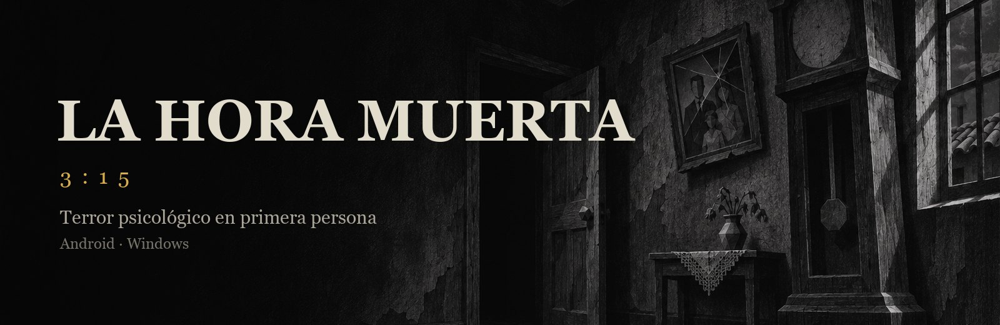
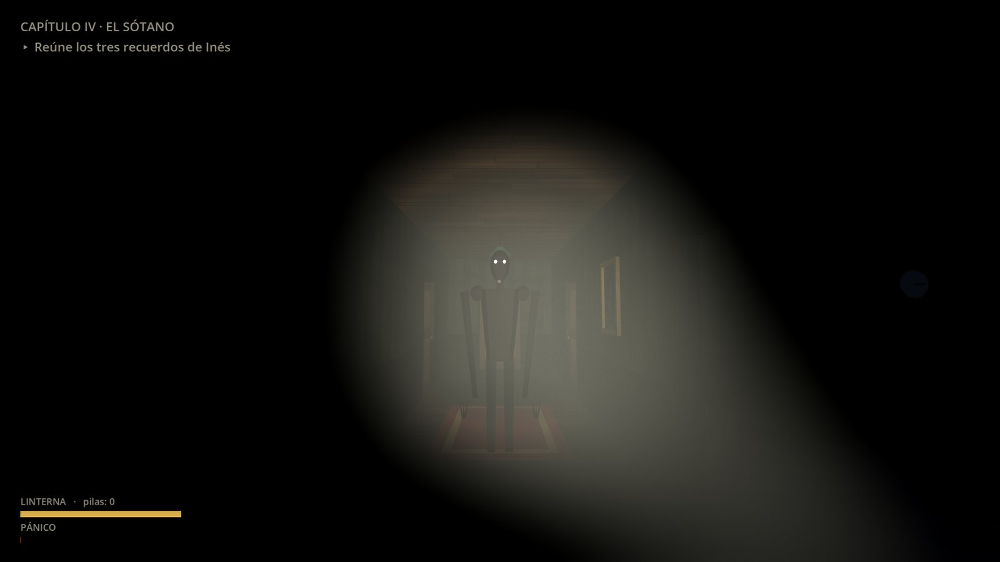
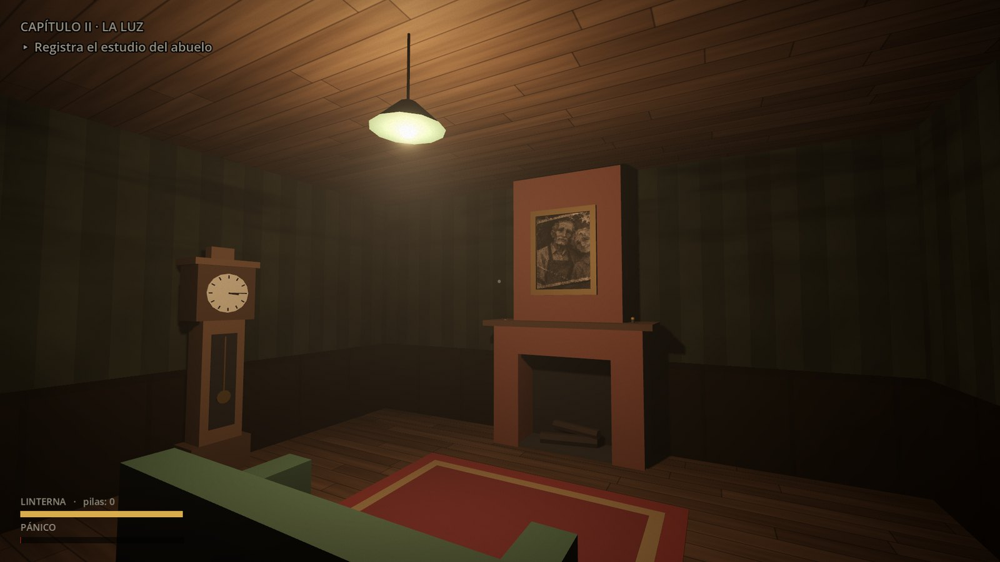
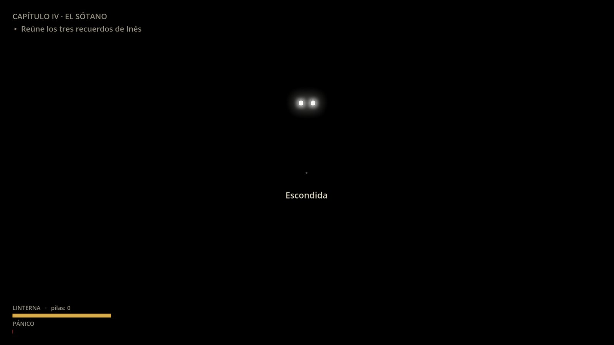
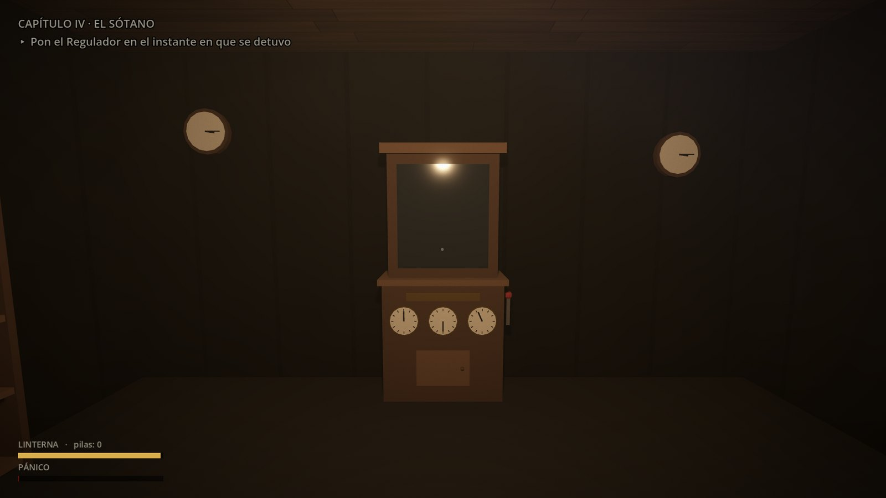
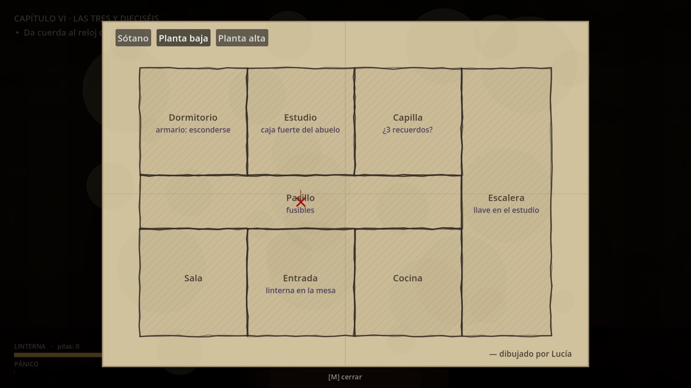
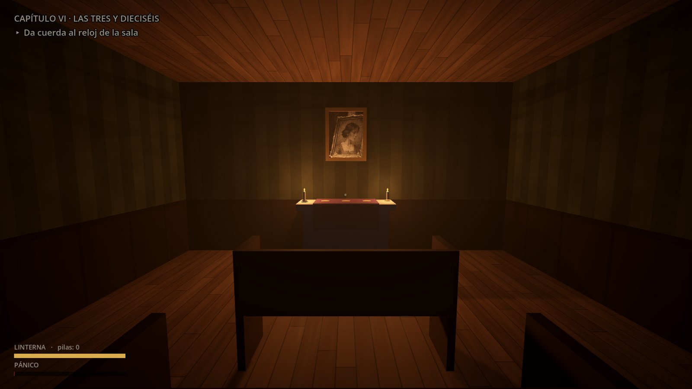

  

  
  
  
  
  

  <a href="README.md">Español</a> · <b>English</b>

---

**La Hora Muerta** (*The Dead Hour*) is a first-person psychological horror game. Explore your grandfather's house, solve its puzzles and survive whatever lives in the dark, with a flashlight, few batteries and a heart that keeps racing.

> Three days without a word from your sister Lucía. Her last message: *"I'm at Grandad's house."*
> When you step inside, the door closes by itself. Every clock in the house shows a quarter past three.

## Download

| Platform | Download | Requirements |
|---|---|---|
| **Android** | [**LaHoraMuerta.apk**](https://github.com/AndyCG03/la-hora-muerta/releases/latest/download/LaHoraMuerta.apk) | Android 7.0 or later, 64-bit, Vulkan support |
| **Windows** | [**LaHoraMuerta-Windows.exe**](https://github.com/AndyCG03/la-hora-muerta/releases/latest/download/LaHoraMuerta-Windows.exe) | 64-bit Windows 10/11, DirectX 12 capable graphics card |

Every version and its checksums are on the [**Releases**](https://github.com/AndyCG03/la-hora-muerta/releases) page.
Step-by-step instructions (in Spanish): [**installation guide**](docs/INSTALACION.md).

## Screenshots

  
  
  
  
  
  

## Features

- **A complete, one-hour story.** Six chapters, notes, letters, diaries and the tapes Lucía recorded. The story moves forward through objectives and the house opens up step by step.
- **A three-floor house:** ground floor, upper floor and cellar. Areas stay locked until you have done what's needed to enter.
- **Puzzles that come from the story.** Codes are deduced from what you read and some change every game, so copying the solution won't work.
- **The flashlight and panic.** Darkness gets to you: heartbeat, breathing, narrowing vision. Batteries are scarce and placed at random every game.
- **The Shadow.** It walks through walls, hears you when you run or open drawers, and light only slows it down. Hide in wardrobes or under beds, watch through the gap and hold your breath when it stops right in front of you.
- **Ways to escape:** close doors to hold it back, throw bottles to distract it, light candelabra that make safe havens and find shortcuts between floors.
- **Furniture that opens:** drawers, wardrobes, cupboards and chests, with whatever they keep inside.
- **Scares and hallucinations** throughout the game, and a final escape.
- **Three endings**, depending on what you discover and how you survive.
- **Lucía's hand-drawn map**, which fills in as you explore.
- **Three difficulty levels.** Easy is meant for enjoying the story.
- **Spanish and English**, with autosave. Play with keyboard and mouse or a touchscreen.

## Controls

| Action | Keyboard & mouse | Touchscreen |
|---|---|---|
| Move / run | `W A S D` / `Shift` | Left stick (push fully to run) |
| Look | Mouse | Drag on the right |
| Use, pick up, open | `E` or click | **USE** |
| Flashlight / replace battery | `F` / `R` | **LIGHT** / **BATT** |
| Hold your breath (while hiding) | `Space` | **BREATH** |
| Throw a bottle | `G` | **THROW** |
| Inventory / map | `Tab` / `M` | **INV** / **MAP** |
| Pause | `Esc` | **II** |

## Content warning

Psychological horror: darkness, jump scares, chases, and themes of grief and loss. No explicit violence or gore. Headphones recommended.

## Reporting a problem

Found a bug? [**Open an issue**](https://github.com/AndyCG03/la-hora-muerta/issues/new/choose) with your device, the game version and what you were doing.

## License

© 2026 AndyCG03. **All rights reserved.** You may download and play the game free of charge for personal use. Redistribution, modification or reuse of its assets is not permitted without permission. See [LICENSE](LICENSE).
