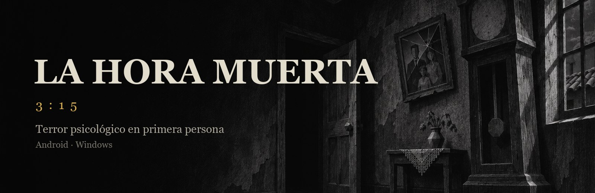
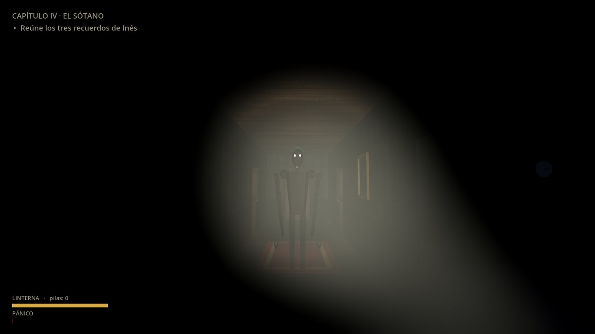
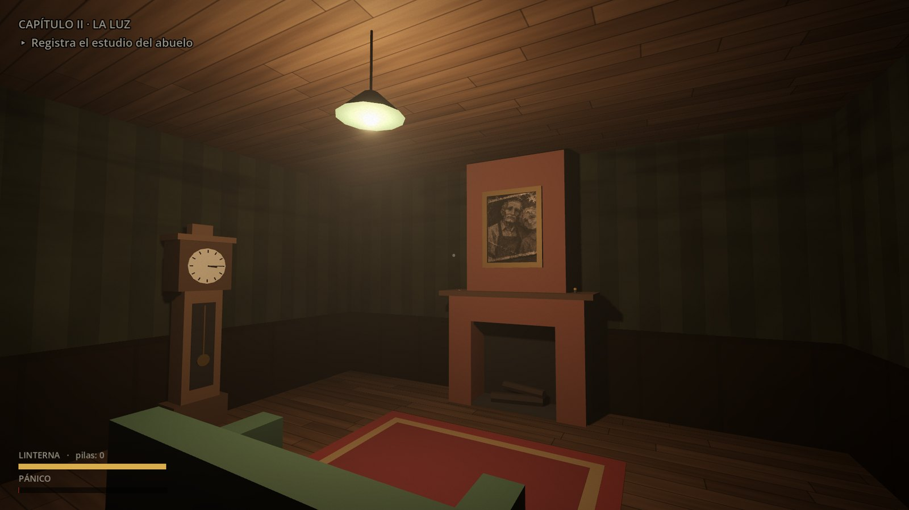
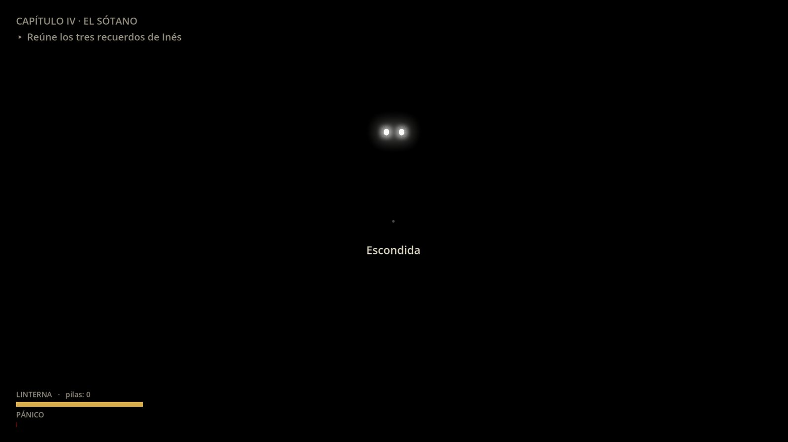
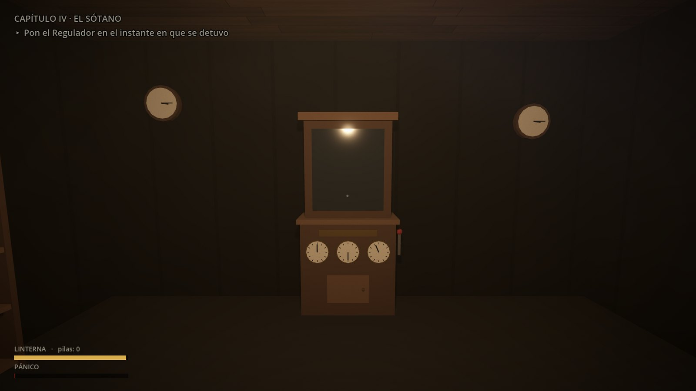
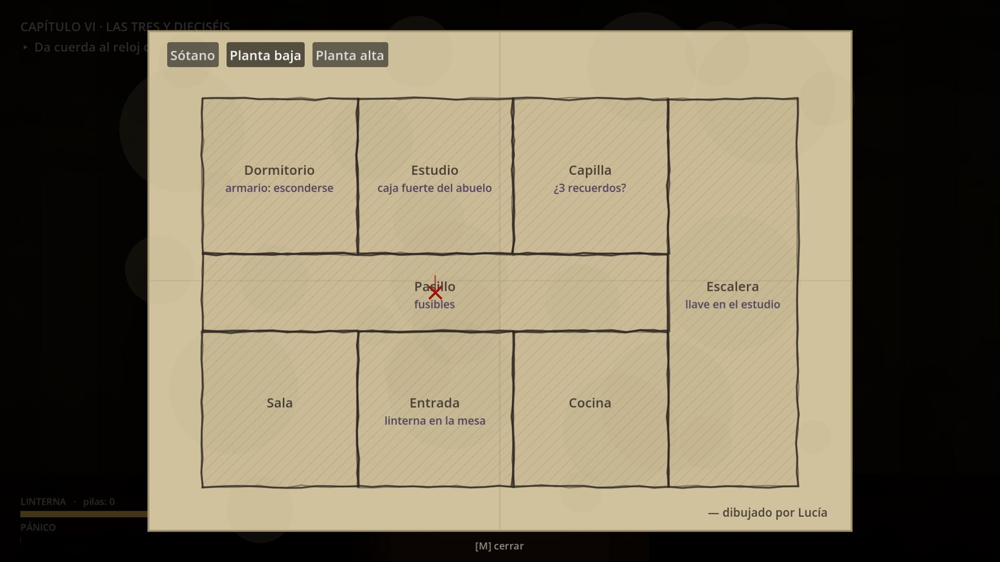
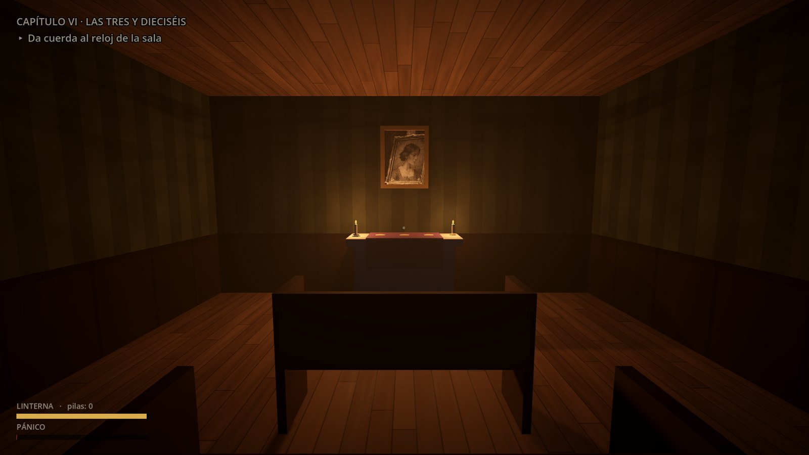

  

  
  
  
  
  

  <b>Español</b> · <a href="README.en.md">English</a>

---

**La Hora Muerta** es un juego de terror psicológico en primera persona. Exploras la casa de tu abuelo, resuelves sus puzzles y sobrevives a lo que vive en la oscuridad, con una linterna, pocas pilas y un corazón que no deja de acelerarse.

> Tres días sin noticias de tu hermana Lucía. Su último mensaje: *«Estoy en casa del abuelo»*.
> Cuando entras, la puerta se cierra sola. Todos los relojes de la casa marcan las tres y cuarto.

## Descargar

| Plataforma | Descarga | Requisitos |
|---|---|---|
| **Android** | [**LaHoraMuerta.apk**](https://github.com/AndyCG03/la-hora-muerta/releases/latest/download/LaHoraMuerta.apk) | Android 7.0 o superior, 64 bits, con soporte Vulkan |
| **Windows** | [**LaHoraMuerta-Windows.exe**](https://github.com/AndyCG03/la-hora-muerta/releases/latest/download/LaHoraMuerta-Windows.exe) | Windows 10/11 de 64 bits, tarjeta gráfica compatible con DirectX 12 |

Todas las versiones y sus sumas de verificación están en [**Releases**](https://github.com/AndyCG03/la-hora-muerta/releases).
Cómo instalarlo paso a paso: [**guía de instalación**](docs/INSTALACION.md).

## Capturas

  
  
  
  
  
  

## Características

- **Una historia completa de una hora.** Seis capítulos, notas, cartas, diarios y las cintas que grabó Lucía. La historia avanza por objetivos y la casa se abre poco a poco.
- **Una casa de tres plantas:** planta baja, planta alta y sótano. Las zonas siguen cerradas hasta que cumples lo necesario para entrar.
- **Puzzles que salen de la historia.** Los códigos se deducen de lo que lees y algunos cambian en cada partida, así que no sirve copiar la solución.
- **La linterna y el pánico.** La oscuridad te altera: latido, respiración, visión que se cierra. Las pilas escasean y se reparten al azar en cada partida.
- **La Sombra.** Atraviesa paredes, te oye cuando corres o abres cajones y huye de la luz directa. Puedes esconderte en armarios o debajo de las camas y contener la respiración.
- **Muebles que se abren:** cajones, armarios, alacenas y baúles, con lo que guarden dentro.
- **Sustos y alucinaciones** a lo largo de toda la partida, y una huida final.
- **Tres finales**, según lo que descubras y cómo sobrevivas.
- **Mapa dibujado a mano por Lucía**, que se completa a medida que exploras.
- **Tres dificultades.** Fácil está pensada para disfrutar de la historia.
- **Español e inglés**, con guardado automático. Se juega con teclado y ratón o con pantalla táctil.

## Cómo se juega

| Acción | Teclado y ratón | Pantalla táctil |
|---|---|---|
| Moverse / correr | `W A S D` / `Mayús` | Palanca izquierda (al tope corre) |
| Mirar | Ratón | Arrastrar a la derecha |
| Usar, recoger, abrir | `E` o clic | **USAR** |
| Linterna / cambiar pila | `F` / `R` | **LUZ** / **PILA** |
| Contener la respiración (escondida) | `Espacio` | **AIRE** |
| Inventario / mapa | `Tab` / `M` | **INV** / **MAPA** |
| Pausa | `Esc` | **II** |

Más detalles y consejos sin destripes en la [**guía de juego**](docs/GUIA.md).

## Documentación

| Documento | Contenido |
|---|---|
| [Guía de juego](docs/GUIA.md) | Mecánicas, consejos, dificultades y finales (sin destripes) |
| [Instalación](docs/INSTALACION.md) | Android y Windows paso a paso, y solución de problemas |
| [Ficha técnica](docs/TECNICO.md) | Cómo está hecho: motor, sistemas, recursos y rendimiento |
| [Privacidad](docs/PRIVACIDAD.md) | Qué datos guarda el juego (solo en tu dispositivo) |
| [Créditos](docs/CREDITOS.md) | Herramientas y recursos utilizados |
| [Cambios](CHANGELOG.md) | Historial de versiones |

## Aviso de contenido

Terror psicológico: oscuridad, sustos repentinos, persecuciones y temas de duelo y pérdida. No contiene violencia explícita ni sangre. Se recomienda jugar con auriculares.

## Informar de un problema

Si encuentras un error, [**abre una incidencia**](https://github.com/AndyCG03/la-hora-muerta/issues/new/choose) e indica tu dispositivo, la versión del juego y qué estabas haciendo.

## Licencia

© 2026 AndyCG03. **Todos los derechos reservados.** Puedes descargar el juego y jugarlo de forma gratuita para uso personal. No está permitido redistribuirlo, modificarlo ni reutilizar sus recursos sin permiso. Consulta [LICENSE](LICENSE).
